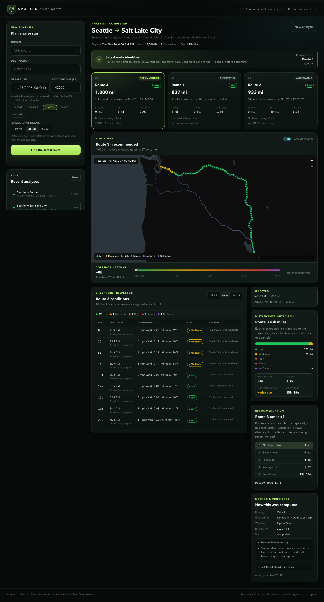

# Spotter Route Safety

Weather-aware truck routing for safer departure decisions. Enter an origin, destination,
departure time, and load weight; the app retrieves three truck-route alternatives, samples the
forecast **at each checkpoint's ETA**, scores wind / rain / snow risk with load overrides, and
recommends the least hazardous route.



## What it does

- **Three route alternatives** from Valhalla truck costing, with Valhalla general traffic and
  OSRM fallbacks when fewer than three distinct truck routes are available.
- **ETA-aware weather** from Open-Meteo: each checkpoint is sampled at the time the truck is
  forecast to reach it, not at departure.
- **Distance-weighted risk**: 10-mile samples drive `no_travel`, `severe`, `high`, and average
  risk metrics. The 25- and 50-mile checkpoint views are display-only.
- **Load-aware overrides** for high wind: `>=55 mph` is No Travel for any load, `45–54 mph` is No
  Travel above 30,000 lb, and `35–44 mph` is Severe above 40,000 lb.
- **Explicit recommendation**: fewest No Travel miles, then Severe miles, then High miles, then
  average risk, then travel time. If every route has No Travel mileage, the least hazardous
  route is shown only as context and marked **not recommended for travel**.
- **Map + 0–48 hour corridor heatmap**: switch routes, inspect every checkpoint, and scrub the
  forecast timeline while the route stays fixed.
- **Persisted analyses**: results stay reproducible after live forecasts change, with saved
  history and deep links (`/#/analysis/<uuid>`).
- **Honest unknowns**: missing forecasts are labelled Unknown, never treated as safe, and
  excluded from average risk rather than counted as zero.

## Stack

| Layer | Technology |
| --- | --- |
| Frontend | React 18, TypeScript, Vite, TanStack Query, MapLibre GL JS |
| Backend | Django 5.2, Django REST Framework, drf-spectacular |
| Data | SQLite locally / single-instance demo, JSON fields, UUID analyses |
| Routing | Valhalla (truck + auto), OSRM fallback |
| Geocoding | Nominatim / OpenStreetMap |
| Weather | Open-Meteo hourly forecasts |
| Ops | Docker Compose, nginx, Gunicorn, GitHub Actions |

No API keys are required.

## Quick start

### 1. Backend

```bash
cd backend
python3 -m venv .venv
.venv/bin/pip install -r requirements-dev.txt
.venv/bin/python manage.py migrate
.venv/bin/python manage.py runserver 127.0.0.1:8000
```

### 2. Frontend

```bash
cd frontend
npm install
npm run dev
```

Open <http://127.0.0.1:5173>. Vite proxies `/api`, `/health`, and `/metrics` to Django on port
8000.

### Optional: deterministic demo data

The live providers are free public services and can occasionally be slow or unavailable. Seed a
captured analysis so the walkthrough always has a complete route set:

```bash
cd backend
.venv/bin/python manage.py seed_demo
```

It is labelled as demo data and can be run repeatedly.

## Docker Compose

```bash
cp .env.example .env    # optional; set a real DJANGO_SECRET_KEY for a public deployment
docker compose up --build
```

Open <http://localhost:8080>. The stack runs migrations on startup, serves the built React app
from nginx, proxies the API to Gunicorn, and persists SQLite data in the `spotter-data` volume.

For a public host:

1. Set `DJANGO_SECRET_KEY` and `DJANGO_ALLOWED_HOSTS` to your domain.
2. Put the frontend behind HTTPS and set `DJANGO_SECURE_SSL_REDIRECT=1` when TLS terminates before
   the app.
3. Point the platform health check at `/health/ready`.
4. If the API is served from a different origin, build the frontend with
   `VITE_API_BASE=https://api.example.com/api/v1` and add the web origin to
   `CORS_ALLOWED_ORIGINS`.

SQLite is intentional for a single-instance assessment deployment. The schema and service layer
are ready for PostgreSQL; switch `DATABASES` and add a driver for multi-instance production.

## API

Base path: `/api/v1`.

| Method | Path | Purpose |
| --- | --- | --- |
| `POST` | `/analyses/` | Run an analysis synchronously (201 with the full detail payload) |
| `GET` | `/analyses/` | Cursor-paginated history |
| `GET` | `/analyses/{uuid}/` | Saved analysis detail |
| `DELETE` | `/analyses/{uuid}/` | Delete a saved analysis |
| `GET` | `/places/?q=` | Autocomplete via Nominatim (max 5) |
| `GET` | `/policy/` | Machine-readable thresholds, load rules, ranking key |
| `GET` | `/openapi/` | OpenAPI 3 schema |

Outside the versioned API: `GET /health/live`, `GET /health/ready`, `GET /metrics`, and Swagger UI
at `/api/docs/`.

Example request:

```bash
curl -X POST http://127.0.0.1:8000/api/v1/analyses/ \
  -H 'Content-Type: application/json' \
  -d '{
    "origin": "Chicago, IL",
    "destination": "Denver, CO",
    "departure": "2026-11-24T15:00:00Z",
    "load_weight_lb": 42000,
    "spacing_miles": 25
  }'
```

Errors use RFC 9457-style problem details with a stable `code`, human `detail`, field `errors`,
and an `X-Correlation-ID` for logs.

## Risk policy (`2026-11-a`)

| Condition | Low | Moderate | High | Severe | No Travel |
| --- | --- | --- | --- | --- | --- |
| Wind (mph) | `<25` | `25–34` | `35–44` | `45–54` | `>=55` |
| Rain (in/hr) | `<0.10` | `0.10–0.25` | `0.25–0.50` | `0.50–1.00` | `>1.00` |
| Snow (in/hr) | `<0.5` | `0.5–1.0` | `1.0–2.0` | `2.0–3.0` | `>3.0` |

Base risk is the worst of wind, rain, and snow. Load overrides are applied afterwards:

- Wind `>=55 mph` → No Travel for every load.
- Wind `45–54 mph` and load `>30,000 lb` → No Travel.
- Wind `35–44 mph` and load `>40,000 lb` → Severe.

Each checkpoint's risk is applied to the road distance around it (midpoint attribution), so the
metrics describe mileage, not a count of samples.

## How an analysis runs

1. Geocode both endpoints (Nominatim, cached and rate-limited).
2. Request truck alternatives from Valhalla; fill with general-traffic and OSRM alternatives until
   three distinct routes are available.
3. Simplify and store geometry; sample checkpoints at 10, 25, and 50 miles.
4. Compute each checkpoint ETA from route distance and duration, then batch-fetch Open-Meteo hourly
   forecasts for the unique coordinates.
5. Sample the forecast valid at each ETA, score base risk, apply load overrides, and attribute
   distance-weighted risk miles.
6. Build a 0–48 hour heatmap at each 10-mile point, rank routes, persist everything, and return the
   assembled payload.

The request is synchronous for the MVP. That keeps the client contract simple and avoids a worker
and polling layer; provider calls are cached and batched, and a cold Chicago–Denver analysis takes
roughly 7–12 seconds.

## Tests and quality gates

```bash
# Backend (66 tests)
cd backend
.venv/bin/python -m pytest
.venv/bin/ruff check .
.venv/bin/ruff format --check .

# Frontend
cd frontend
npm run typecheck
npm run lint
npm run build
```

CI (`.github/workflows/ci.yml`) enforces backend lint/format/tests, frontend typecheck/lint/build,
and Docker image builds.

## Project layout

```text
backend/
  config/                 Django settings, URLs, WSGI
  core/
    services/             geocoding, routing, weather, risk, geo, analysis pipeline
    management/commands/  seed_demo
    fixtures/             captured deterministic demo payload
    tests/                risk, geo, pipeline, API tests
    models.py             persisted analyses, routes, checkpoints, events
    views.py              API, health, metrics, OpenAPI
frontend/
  src/
    components/           form, history, route cards, map, inspector, results
    lib/                  API client, formatting and risk helpers
    types.ts              API payload types
  deploy/nginx.conf       SPA + API reverse proxy
docs/
  WALKTHROUGH.md          five-to-ten minute demo script
  screenshot.png          analysis view
```

## Deliberate MVP trade-offs

- **Synchronous analysis.** Simpler contract and deployment; a production version should move to a
  queued job with progress events once provider latency or traffic grows.
- **No accounts or auth.** Analyses are public by UUID for the assessment. Add authentication and
  ownership before storing user-specific data.
- **Public free providers.** No API keys, but availability and rate limits are outside our control.
  Adapters isolate providers so a commercial routing or weather API can be swapped in.
- **SQLite.** Good for a single instance and zero-ops demo; PostgreSQL is the production path.
- **Forecast advisory, not a road report.** The score does not model closures, chain controls,
  visibility, ice, driver skill, or vehicle configuration beyond load weight.

See [docs/WALKTHROUGH.md](docs/WALKTHROUGH.md) for the demo script.
